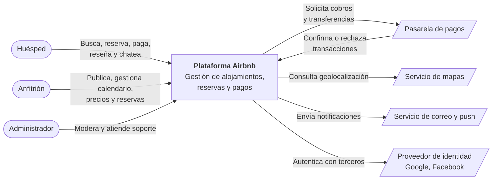

# 4. Diagrama de contexto

El diagrama de contexto muestra el sistema como una **caja negra** y su relación
con los actores y sistemas externos.

## 4.1 Descripción de las interacciones

| Entidad | Tipo | Interacción con el sistema |
|---|---|---|
| Huésped | Actor | Busca alojamientos, reserva, paga, califica y se comunica con el anfitrión |
| Anfitrión | Actor | Publica propiedades, administra calendario y precios, responde reservas |
| Administrador | Actor | Modera contenido y usuarios, atiende incidencias |
| Pasarela de pagos | Sistema externo | Procesa cobros, pagos al anfitrión y reembolsos |
| Servicio de mapas | Sistema externo | Entrega geocodificación y mapas para la búsqueda |
| Servicio de correo y push | Sistema externo | Entrega correos y notificaciones a los usuarios |
| Proveedor de identidad | Sistema externo | Permite iniciar sesión con Google o Facebook |