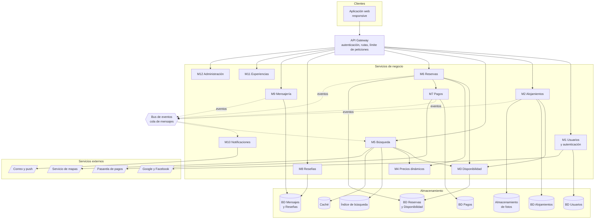

# 5. Diagrama de componentes

La arquitectura propuesta es **modular por servicios**: un cliente web, un API
Gateway y servicios independientes, cada uno con su propia base de datos.

## 5.1 Descripción de los componentes

| Componente | Función |
|---|---|
| Aplicación web | Interfaz para huéspedes, anfitriones y administradores |
| API Gateway | Punto único de entrada: valida tokens, enruta y limita peticiones |
| Servicios M1 a M12 | Lógica de negocio de cada módulo, desplegables por separado |
| Bus de eventos | Comunicación asíncrona entre servicios (reserva creada, pago confirmado) |
| Índice de búsqueda | Copia optimizada de alojamientos para consultas rápidas |
| Caché | Guarda resultados frecuentes para bajar la latencia |
| Almacenamiento de fotos | Guarda imágenes y archivos fuera de la base de datos |

## 5.2 Decisiones clave

- **Una base de datos por servicio:** cada módulo es dueño de sus datos, así se reduce el acoplamiento.
- **Comunicación asíncrona por eventos:** Notificaciones y Búsqueda se actualizan sin frenar al servicio que origina el evento.
- **Reservas y Disponibilidad comparten base de datos:** es lo que permite garantizar, con transacciones, que no haya dobles reservas (RNF-08).
- **API Gateway:** centraliza la seguridad y simplifica el cliente.