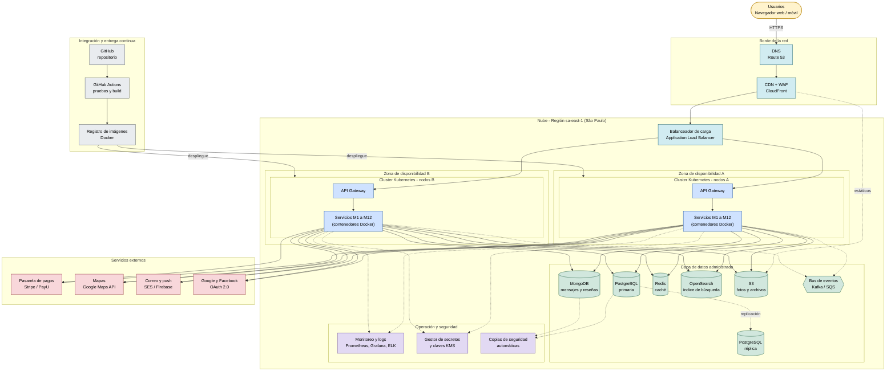

# 6. Diagrama de despliegue

El despliegue propuesto usa **computación en la nube** (ejemplo con AWS), con
contenedores orquestados en Kubernetes, bases de datos administradas y
distribución en **varias zonas de disponibilidad** para cumplir la
disponibilidad del 99,9 % (RNF-03).

## 6.1 Descripción de los nodos

| Nodo | Tecnología | Función |
|---|---|---|
| DNS | Route 53 | Resuelve el dominio y dirige el tráfico |
| CDN + WAF | CloudFront | Entrega contenido estático rápido y filtra ataques (inyección SQL, XSS, DDoS) |
| Balanceador de carga | Application Load Balancer | Reparte las peticiones entre las zonas de disponibilidad |
| Cluster Kubernetes | EKS | Ejecuta los contenedores y escala automáticamente según la carga |
| API Gateway | Kong / NGINX | Valida tokens, enruta y limita peticiones |
| Servicios M1 a M12 | Contenedores Docker | Lógica de negocio de cada módulo |
| PostgreSQL | RDS Multi-AZ | Datos transaccionales: usuarios, alojamientos, reservas, pagos |
| MongoDB | Atlas / DocumentDB | Mensajes y reseñas (alto volumen, esquema flexible) |
| Redis | ElastiCache | Caché de búsquedas y sesiones |
| OpenSearch | Amazon OpenSearch | Búsqueda por texto, filtros y geolocalización |
| S3 | Amazon S3 | Fotos de propiedades y documentos |
| Bus de eventos | Kafka / SQS | Comunicación asíncrona entre servicios |
| Monitoreo | Prometheus, Grafana, ELK | Métricas, logs y alertas (RNF-12) |
| Secretos y claves | Secrets Manager, KMS | Protege credenciales y cifrado de datos (RNF-04) |
| Copias de seguridad | Snapshots automáticos | Recuperación ante desastres (RNF-13) |

## 6.2 Decisiones de despliegue

- **Dos zonas de disponibilidad:** si una falla, la otra sigue atendiendo (alta disponibilidad).
- **Región São Paulo:** es la más cercana a Colombia, lo que reduce la latencia.
- **Escalado horizontal:** Kubernetes agrega o quita contenedores según el tráfico (RNF-02).
- **Réplica de lectura de PostgreSQL:** descarga las consultas de lectura de la base principal.
- **CDN y WAF delante de todo:** protege y acelera antes de llegar a los servidores.
- **CI/CD con GitHub Actions:** cada cambio se prueba, se empaqueta en una imagen Docker y se despliega de forma automática.

## 6.3 Ambientes

| Ambiente | Propósito |
|---|---|
| Desarrollo | Pruebas de cada desarrollador |
| Staging | Réplica reducida de producción para pruebas finales |
| Producción | Sistema real con alta disponibilidad |