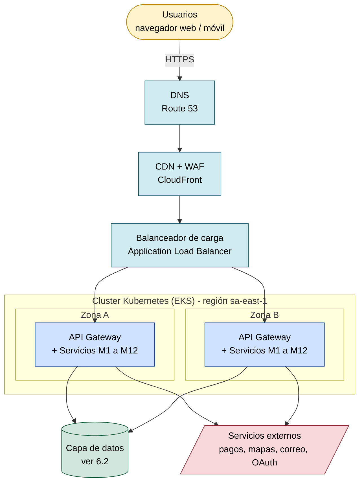
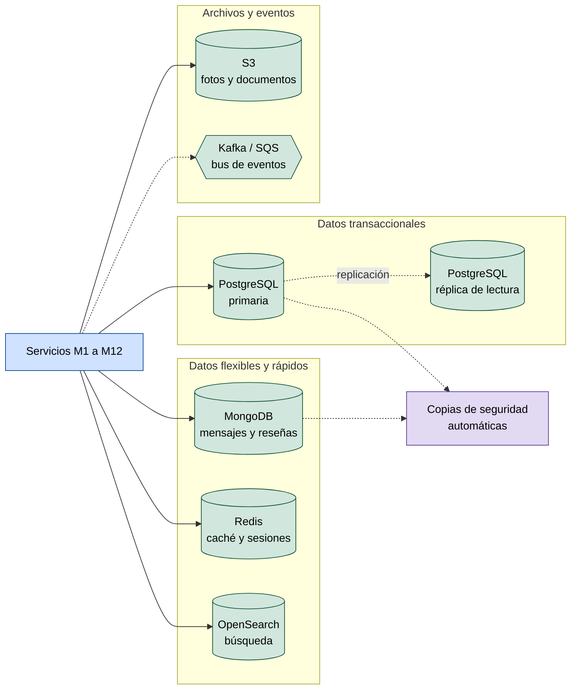
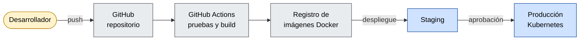

# 6. Diagrama de despliegue

El despliegue propuesto usa **computación en la nube** (ejemplo con AWS), con
contenedores en Kubernetes, bases de datos administradas y dos zonas de
disponibilidad para cumplir la disponibilidad del 99,9 % (RNF-03).

Se presenta en tres vistas: infraestructura principal, capa de datos y
entrega continua.

## 6.1 Vista de infraestructura

## 6.2 Vista de la capa de datos

## 6.3 Vista de entrega continua (CI/CD)

## 6.4 Descripción de los nodos

| Nodo | Tecnología | Función |
|---|---|---|
| DNS | Route 53 | Resuelve el dominio y dirige el tráfico |
| CDN + WAF | CloudFront | Entrega contenido estático y filtra ataques (inyección SQL, XSS, DDoS) |
| Balanceador de carga | Application Load Balancer | Reparte las peticiones entre las zonas |
| Cluster Kubernetes | EKS | Ejecuta contenedores y escala según la carga |
| API Gateway | Kong / NGINX | Valida tokens, enruta y limita peticiones |
| Servicios M1 a M12 | Contenedores Docker | Lógica de negocio de cada módulo |
| PostgreSQL | RDS Multi-AZ | Usuarios, alojamientos, reservas y pagos |
| MongoDB | Atlas / DocumentDB | Mensajes y reseñas (alto volumen, esquema flexible) |
| Redis | ElastiCache | Caché de búsquedas y sesiones |
| OpenSearch | Amazon OpenSearch | Búsqueda por texto, filtros y geolocalización |
| S3 | Amazon S3 | Fotos de propiedades y documentos |
| Bus de eventos | Kafka / SQS | Comunicación asíncrona entre servicios |
| Monitoreo y logs | Prometheus, Grafana, ELK | Métricas y alertas (RNF-12) |
| Secretos y claves | Secrets Manager, KMS | Protege credenciales y cifrado (RNF-04) |
| Copias de seguridad | Snapshots automáticos | Recuperación ante desastres (RNF-13) |

## 6.5 Decisiones de despliegue

- **Dos zonas de disponibilidad:** si una falla, la otra sigue atendiendo.
- **Región São Paulo:** la más cercana a Colombia, menor latencia.
- **Escalado horizontal:** Kubernetes agrega o quita contenedores según el tráfico (RNF-02).
- **Réplica de lectura:** descarga las consultas de la base principal.
- **CDN y WAF delante de todo:** protegen y aceleran antes de llegar a los servidores.
- **CI/CD con GitHub Actions:** cada cambio se prueba, se empaqueta y se despliega de forma automática.

## 6.6 Ambientes

| Ambiente | Propósito |
|---|---|
| Desarrollo | Pruebas de cada desarrollador |
| Staging | Réplica reducida de producción para pruebas finales |
| Producción | Sistema real con alta disponibilidad |