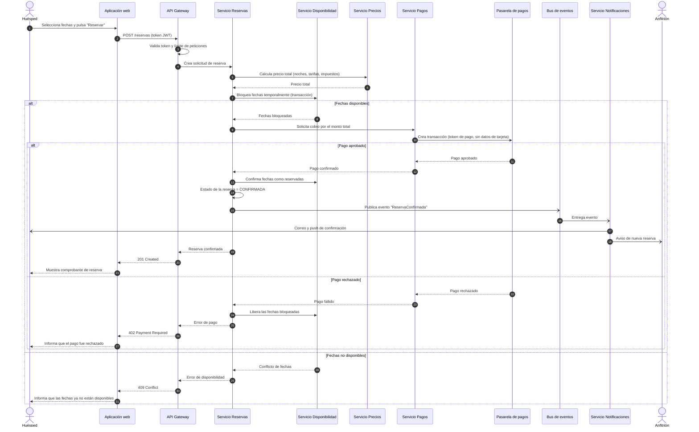
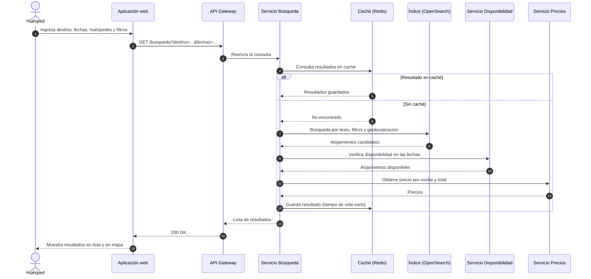
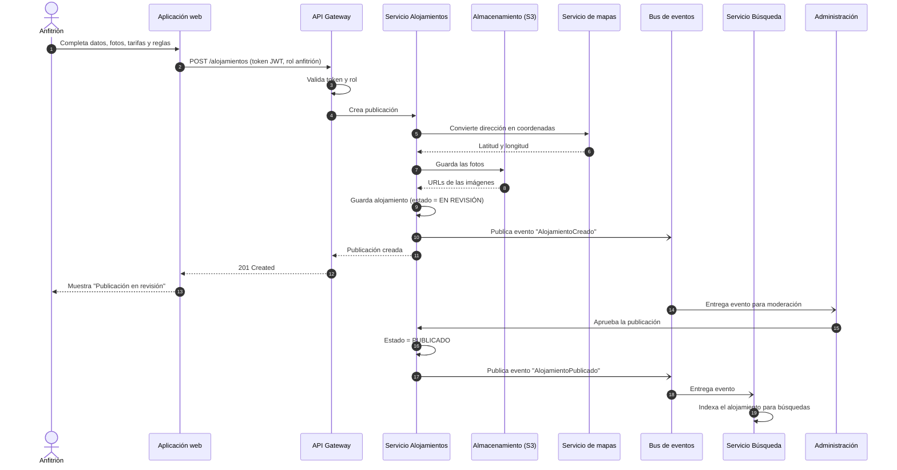

# 7. Diagramas de secuencia

Se presentan tres casos de uso representativos:

1. Realizar una reserva con pago seguro
2. Buscar alojamientos por destino y fechas
3. Publicar un alojamiento

## 7.1 Caso de uso 1: Reserva con pago seguro

**Actor:** Huésped
**Requerimientos relacionados:** RF-09, RF-11, RF-12, RNF-06, RNF-08
**Precondición:** el huésped ha iniciado sesión y eligió un alojamiento con fechas.

**Puntos clave:**
- Las fechas se **bloquean antes de cobrar**, así dos huéspedes no pueden reservar lo mismo (RNF-08).
- La aplicación nunca maneja datos de tarjeta: solo un **token** que entrega la pasarela (RNF-06).
- Notificaciones se envía por **evento asíncrono**, para no demorar la respuesta al huésped.
- Si el pago falla, las fechas se **liberan** de inmediato.

## 7.2 Caso de uso 2: Búsqueda de alojamientos

**Actor:** Huésped
**Requerimientos relacionados:** RF-07, RF-08, RNF-01

**Puntos clave:**
- La **caché** evita repetir consultas costosas y ayuda a cumplir el tiempo menor a 2 segundos (RNF-01).
- La búsqueda usa un **índice especializado**, no la base de datos transaccional.
- La disponibilidad se verifica **después** de filtrar, para consultar solo los candidatos.

## 7.3 Caso de uso 3: Publicar un alojamiento

**Actor:** Anfitrión
**Requerimientos relacionados:** RF-03, RF-05, RF-06

**Puntos clave:**
- Toda publicación pasa por **moderación** antes de ser visible (RF-19).
- La indexación en Búsqueda es **asíncrona**: no hace esperar al anfitrión.
- Las fotos van a almacenamiento de objetos, no a la base de datos.